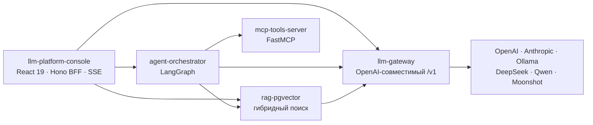

<h1 align="center">Антон Журавлёв</h1>

  <b>Senior Fullstack / Backend Engineer · Tech Lead</b> 
  Node.js · NestJS · TypeScript · PostgreSQL · React / Vue · AI-native

  
  
  
  

---

Строю backend, который держит деньги и нагрузку: биллинг, платёжные интеграции, realtime, очереди и события. Последние годы совмещаю разработку с тимлидством: архитектура, найм, ревью, 1:1. Работаю AI-native: Claude Code и Cursor в ежедневном процессе, но за результат отвечает инженер, а не агент.

## LLM-платформа

Пять сервисов, которые вместе дают исследовательского AI-агента с честными цитатами и полным учётом расхода. Поднимается одной командой и работает офлайн на детерминированном мок-провайдере, без единого ключа. У каждого сервиса CI и тесты, у шлюза, RAG и агента ещё OpenAPI-контракты и evals.

| Сервис | Что умеет | Версия |
|---|---|---|
| [**llm-gateway**](https://github.com/INTERpol21/llm-gateway) | Один OpenAI-совместимый `/v1` к шести провайдерам: маршрутизация с алиасами и цепочками фолбэков, ретраи с full-jitter backoff, circuit breakers, точный и семантический кеш, rate limits и стоимость по ключам, обратимое вырезание персональных данных до провайдера, телеметрия в Postgres и Prometheus | v1.44 |
| [**rag-pgvector**](https://github.com/INTERpol21/rag-pgvector) | Ingest и query с цитатами `[n]`: гибридный ретривал (pgvector + BM25 / Postgres FTS) со слиянием convex или RRF, опциональный реранкер, evals с LLM-as-a-judge | v1.38 |
| [**agent-orchestrator**](https://github.com/INTERpol21/agent-orchestrator) | Исследовательский агент на LangGraph: plan → execute → reflect → synthesize, параллельный сбор улик, трасса каждого шага, деградация без 500-х, чекпоинты в Postgres | v1.44 |
| [**mcp-tools-server**](https://github.com/INTERpol21/mcp-tools-server) | MCP-сервер на FastMCP: веб-поиск, read-only SQL, файловая песочница, `fetch_url` с защитой от SSRF; транспорты stdio и streamable HTTP из одной кодовой базы | v1.17 |
| [**llm-platform-console**](https://github.com/INTERpol21/llm-platform-console) | Консоль и «зонт» платформы: чат с живой трассой агента по SSE, каталог моделей, расход и стоимость, база знаний; весь стек одной командой | v1.92 |

## Где и что делал

**Volta Tech** · Senior Fullstack → Tech Lead команды из 8 · 2025–2026 
Highload iGaming-платформа: 4000+ игр, KYC, платежи, бонусы, турниры, сотни тысяч пользователей, 170+ инженеров. AI-направление ERA2: кредитно-биллинговая система на 90+ тарифных моделей с успешностью транзакций 95%+. Redis-кеш ускорил ключевые экраны на 30–40%.

**Competent IT** · Senior Backend → Team Lead · 2024–2025 
Web3-платформа Meta Force Space: 2M+ пользователей, Polygon, NestJS/TypeORM. MVP в прод меньше чем за 4 месяца.

**PR-группа Буржуй** · Fullstack → Tech Lead · 2022–2024 
[Kefirium](https://kefirium.ru): первый рублёвый NFT-маркетплейс в РФ. Live-аукцион Soda AVS: ставки по WebSocket быстрее 300 мс при конкурентной записи. Платёжная B2B-платформа PayQR.Global: ACID, идемпотентные вебхуки, 3+ платёжных шлюза.

## Стек

**Backend**&nbsp;       

**Данные и очереди**&nbsp;      

**Frontend**&nbsp;    

**Инфраструктура**&nbsp;      

**AI**&nbsp;       

## Другие проекты

| Проект | Что внутри | Стек |
|---|---|---|
| [**Support_chat**](https://github.com/INTERpol21/Support_chat) | Чат поддержки «клиент ↔ оператор»: realtime через Centrifugo, история в PostgreSQL, восстановление состояния после перезагрузки, индикатор набора и счётчики непрочитанных | NestJS 11, Prisma 7, Next.js 16, React 19 |
| [**Management-service**](https://github.com/INTERpol21/Management-service) | Сервис обзвона: выдача контактов на PL/pgSQL, вебхуки телефонии с HMAC-подписью, изоляция организаций через RLS, стриминг разбора звонка от LLM в UI | FastAPI, asyncpg, PostgreSQL 16, React |
| [**pro134**](https://github.com/INTERpol21/pro134) | Микросервисы уведомлений: publisher confirms, manual ack, ретраи с backoff, DLQ, идемпотентность по UUID | NestJS, RabbitMQ, Telegram Bot API |
| [**deposit**](https://github.com/INTERpol21/deposit) | Залог и выкуп с расчётом процентов. E2E-тесты на гонки: из пяти параллельных выкупов проходит ровно один | NestJS, TypeORM, PostgreSQL, React |
| [**Freight-auctions**](https://github.com/INTERpol21/Freight-auctions) | SPA грузовых аукционов: OpenAPI-контракт и Zod на границе, Feature-Sliced Design, MSW с живым состоянием | React 19, TanStack Router/Query, Zustand |
| [**ab-lab**](https://github.com/INTERpol21/ab-lab) | Лаборатория AI-экспериментов: один Zod-контракт на весь монорепо, Redis-кеш с тегами и атомарной инвалидацией через Lua, Demo Runner на SSE | NestJS 11, Next.js 16, Zod, Redis |
| [**seo-description-generator**](https://github.com/INTERpol21/seo-description-generator) | Генерация SEO-контента через Flowise: SSE-стриминг и строгая JSON-схема ответа | NestJS, Flowise, SSE |
| [**Subscription-Sync-Dashboard**](https://github.com/INTERpol21/Subscription-Sync-Dashboard) | Идемпотентная синхронизация подписок из Stripe-подобного API, частичные сбои не роняют синк | PHP 8.3, Phalcon 5, Vue 3 |
| [**accounts-form**](https://github.com/INTERpol21/accounts-form) | Форма управления учётными записями с персистентностью, unit- и e2e-тестами | Vue 3, TypeScript, Pinia, Playwright |

## Живые продукты

- [**era2.ai**](https://era2.ai): AI-платформа, кредитно-биллинговая система (Volta Tech)
- [**kefirium.ru**](https://kefirium.ru): первый рублёвый NFT-маркетплейс в РФ

## Как работаю

- **Тесты всегда.** Jest, unit и integration; конкурентные сценарии проверяю отдельно, а не надеюсь на удачу.
- **Идемпотентность и транзакции по умолчанию.** Деньги, вебхуки и очереди проектирую под повторы и гонки: row-level locking, ключи идемпотентности, DLQ.
- **AI-native, но с ответственностью.** Агенту отдаю задачу с контекстом и критериями приёмки, результат проверяю ревью и прогоном тестов.
- **Наблюдаемость с первого дня.** Метрики, алерты и Sentry ставлю до прода, а не после первого инцидента.

---

Открыт к предложениям: Senior Fullstack / Backend, Tech Lead. Удалёнка или гибрид. 
Быстрее всего ответа можно добиться в <a href="https://t.me/olddeveloper21">Telegram</a>.

