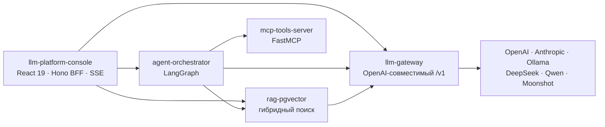

  

  

  
  
  

  

Senior Fullstack / Backend и Tech Lead, 7+ лет. Делаю продукты end-to-end — от схемы БД и очередей до интерфейса и релиза — и веду команды. Последние два года: высоконагруженная iGaming-платформа на 170+ инженеров и AI-направление ERA2, где я собрал платформенное ядро для 12+ AI-продуктов и вырос до Tech Lead команды из 8.

## ⚡ AI-ядро

В ERA2 на одном ядре работают 12+ продуктов: единый шлюз, на котором сейчас работает 151+ нейросеть от 15+ провайдеров, асинхронная очередь генераций, RAG на pgvector и общий кредитный биллинг. Новый продукт подключается конфигом, а не форком сервиса. **LLM-платформа ниже — те же архитектурные идеи в открытом коде**: пять сервисов, которые вместе дают исследовательского агента с честными цитатами и полным учётом расхода. Поднимается одной командой и работает офлайн на детерминированном мок-провайдере.

| Сервис | Что внутри | CI |
|---|---|---|
| [**llm-gateway**](https://github.com/INTERpol21/llm-gateway) | Один OpenAI-совместимый `/v1` к шести провайдерам: маршрутизация с алиасами и цепочками фолбэков, ретраи с full-jitter backoff, circuit breakers, точный и семантический кеш, rate limits и стоимость по ключам, обратимое вырезание персональных данных до провайдера, телеметрия в Postgres и Prometheus |  |
| [**rag-pgvector**](https://github.com/INTERpol21/rag-pgvector) | Поиск с цитатами `[n]`: гибридный ретривал (pgvector + BM25 / Postgres FTS) со слиянием convex или RRF, реранкер, evals с LLM-as-a-judge |  |
| [**agent-orchestrator**](https://github.com/INTERpol21/agent-orchestrator) | Исследовательский агент на LangGraph: plan → execute → reflect → synthesize, параллельный сбор улик, трасса каждого шага, деградация без 500-х, чекпоинты в Postgres |  |
| [**mcp-tools-server**](https://github.com/INTERpol21/mcp-tools-server) | MCP-сервер на FastMCP: веб-поиск, read-only SQL, файловая песочница, `fetch_url` с защитой от SSRF; stdio и streamable HTTP из одной кодовой базы |  |
| [**llm-platform-console**](https://github.com/INTERpol21/llm-platform-console) | Консоль платформы: чат с живой трассой агента по SSE, каталог моделей, расход и стоимость, база знаний; весь стек одной командой |  |

## 🚀 Продукты

20+ продуктов за 7 лет — от AI-экосистемы и Web3 до платежей, PropTech и e-commerce. 🟢 — работает сейчас, 🗄 — продукт закрыт, ссылка ведёт на снимок в Web Archive.

<table>
<tr><th align="left">Продукт</th><th align="left">Что это и что делал я</th><th align="left">Стек</th><th align="left">Ссылка</th></tr>

<tr><td colspan="4"><b>Volta Tech · ERA2</b> — 2025–2026</td></tr>
<tr><td><b>ERA2</b></td><td>Экосистема 12+ AI-продуктов на одном ядре — собрал ядро: шлюз, на котором сейчас работает 151+ нейросеть, очередь генераций, RAG, кредитный биллинг; Tech Lead команды 8</td><td>Python · FastAPI · Celery · pgvector · Vue 3</td><td>🟢 <a href="https://era2.ai">era2.ai</a></td></tr>
<tr><td><b>NeyroHub</b></td><td>Агрегатор 151+ нейросетей: текст, изображения, видео — на общем шлюзе и биллинге</td><td>FastAPI · PostgreSQL · Redis</td><td>🟢 <a href="https://neyrohub.io">neyrohub.io</a></td></tr>
<tr><td><b>+Вайб</b></td><td>ИИ-фотостудия: нейрофотосессия по фото, 6000+ образов</td><td>FastAPI · Celery · очереди генераций</td><td>🟢 <a href="https://vibeplus.ai">vibeplus.ai</a></td></tr>
<tr><td><b>iVox Studio</b></td><td>AI-озвучка и клон голоса: 200+ голосов, 70+ языков, словарь ударений из общего RAG</td><td>TTS · FastAPI · RAG</td><td>🟢 <a href="https://voice.era2.ai">voice.era2.ai</a></td></tr>
<tr><td><b>Music Era2</b></td><td>Генерация песен и музыки</td><td>FastAPI · очереди генераций</td><td>🟢 <a href="https://music.era2.ai">music.era2.ai</a></td></tr>
<tr><td><b>Telegram-линейка ERA2</b></td><td>FOX AI (видео-модели Veo, Sora, Kling, Runway, Luma, Pika), AI BERRY (карточки для Wildberries и Ozon), ПесняAI, БананоГен, MagiaPic, Wow Frame, Click-Click, Trend Video AI — все на том же ядре</td><td>Telegram Bot API · FastAPI</td><td>🟢 Telegram</td></tr>
<tr><td><b>iGaming-платформа Volta</b></td><td>4 000+ игр от 50+ провайдеров, платежи, бонусы, турниры, сотни тысяч пользователей — Team Lead Frontend трёх команд, админка и бэк-офис</td><td>Vue 3 · Nuxt 3 · NestJS · Laravel · Kafka · ClickHouse</td><td>—</td></tr>

<tr><td colspan="4"><b>Competent IT</b> — 2024–2025</td></tr>
<tr><td><b>Meta Force Space</b></td><td>Международная Web3-платформа на Polygon, 2M+ пользователей: маркетплейс, академия, W-DEX swap, Meta Whale — fullstack-архитектура, MVP за 4 месяца</td><td>React 18 · Vue 3 · NestJS · ethers.js · Kubernetes</td><td>🗄 <a href="https://web.archive.org/web/20250121/https://meta-force.space/">meta-force.space</a></td></tr>
<tr><td><b>Дизайн-система Competent IT</b></td><td>40+ типизированных компонентов для 3+ команд, npm publish и CI/CD — сборка интерфейсов в 2 раза быстрее</td><td>React · Next.js · Tailwind · Storybook</td><td>—</td></tr>

<tr><td colspan="4"><b>PR-группа Буржуй</b> — 2022–2024</td></tr>
<tr><td><b>Kefirium</b></td><td>Первый рублёвый NFT-маркетплейс в РФ: каталог на тысячи позиций, live-дропы, фиатный шлюз, смарт-контракты</td><td>Nuxt SSR/PWA · Node.js · Solidity · IPFS</td><td>🟢 <a href="https://kefirium.ru">kefirium.ru</a></td></tr>
<tr><td><b>Soda AVS</b></td><td>Live-аукцион в экосистеме Kefirium: ставки по WebSocket быстрее 300 мс при сотнях участников</td><td>Nuxt · Node.js · WebSocket · PostgreSQL</td><td>—</td></tr>
<tr><td><b>PayQR.Global</b></td><td>Платёжная B2B-платформа для торговли с Азией: P2P-сделки, статусные машины, идемпотентные вебхуки, 3+ шлюза</td><td>Vue 2 · Node.js · PostgreSQL · Redis</td><td>🗄 <a href="https://web.archive.org/web/20230403/https://payqr.global/">payqr.global</a></td></tr>
<tr><td><b>Noglasses</b></td><td>Сайт офтальмологической клиники с интеграцией ПроДокторов и админкой</td><td>Vue · REST · SEO</td><td>🟢 <a href="https://noglasses.ru">noglasses.ru</a></td></tr>
<tr><td><b>Car-City</b></td><td>Аренда и лизинг авто для такси: калькуляторы, каталог, заявки</td><td>Vue · Nginx</td><td>🟢 <a href="https://car-city.pro">car-city.pro</a></td></tr>
<tr><td><b>GastroTula</b></td><td>Гастрономический путеводитель с интерактивной картой и e-commerce</td><td>Vue · SCSS · REST</td><td>🗄 <a href="https://web.archive.org/web/20260113/https://gastrotula.ru/">gastrotula.ru</a></td></tr>

<tr><td colspan="4"><b>Routeam</b> — 2021–2022</td></tr>
<tr><td><b>Онлайн-аптека</b></td><td>Складской модуль федеральной аптечной сети: 5 000+ пользователей в сутки, 100 000+ позиций, загрузка быстрее на 40%</td><td>React 18 · Redux Toolkit · React Query</td><td>—</td></tr>

<tr><td colspan="4"><b>ИП Полуэктов</b> — 2020–2021, соло от схемы БД до деплоя</td></tr>
<tr><td><b>Upravhouse</b></td><td>Цифровая платформа для ЖКХ: CRM заявок, SLA-уведомления, Telegram-бот — минус 40% нагрузки на колл-центр</td><td>Vue · Node.js · PostgreSQL</td><td>🗄 <a href="https://web.archive.org/web/20250423/https://upravhouse.ru/">upravhouse.ru</a></td></tr>
<tr><td><b>Leverans</b></td><td>Доставка еды с CRM колл-центра: каталог, заказы, операторы — заказов на 30% больше</td><td>Vue · Node.js · PostgreSQL</td><td>🗄 <a href="https://web.archive.org/web/20260419/https://omsk.leverans.ru/">omsk.leverans.ru</a></td></tr>

<tr><td colspan="4"><b>Asmart-group</b> — 2019–2020</td></tr>
<tr><td><b>Zoloto55</b></td><td>Ювелирный интернет-магазин: каталог, фильтры, загрузка до 1,8 с</td><td>Vue 2 · SCSS</td><td>🟢 <a href="https://zoloto55.ru">zoloto55.ru</a></td></tr>
<tr><td><b>GotoOmsk</b></td><td>Портал Туристского информационного центра Омской области</td><td>Vue 2 · REST</td><td>🗄 <a href="https://web.archive.org/web/20260613/https://gotoomsk.ru/">gotoomsk.ru</a></td></tr>
</table>

## 🧭 Опыт

**Volta Tech · ERA2** — Senior Fullstack → Team Lead → Tech Lead команды 8 · *июль 2025 — июнь 2026*
- Собрал платформенное ядро для 12+ AI-продуктов: gateway на FastAPI — шлюз, на котором сейчас работает 151+ нейросеть (роутинг, structured output, tool calling, MCP, фолбэки — неуспешных генераций меньше 1%), асинхронный слой на Celery и Redis/RabbitMQ — отклик API быстрее в 3–4 раза.
- RAG на PostgreSQL + pgvector: HNSW, гибридный поиск с реранкером, evals LLM-as-a-judge — ~120 тыс. чанков, p95 retrieval ~120 мс, точность на эталонном наборе с ~70% до ~90%.
- Кредитный биллинг на 90+ тарифов с ЮKassa и СБП: леджер на PostgreSQL с row-level locking и идемпотентностью, 95%+ успешных транзакций.
- iGaming-платформа: 4 000+ игр от 50+ провайдеров, интеграции с 10+ микросервисами, шина RabbitMQ/Kafka, Redis-кеш — ключевые экраны быстрее на 30–40%; миграция Vue 2 → 3, Playwright + Allure на 100+ сценариев.
- Team Lead Frontend трёх кросс-функциональных команд, затем Tech Lead ERA2: найм, перформанс-ревью, 1:1, архитектура, релизный процесс.

**Competent IT** — Senior Fullstack → Team Lead · *июль 2024 — июль 2025*
- Web3-платформа Meta Force Space (2M+ пользователей, Polygon): fullstack-архитектура на React 18, Vue 3, NestJS и PostgreSQL, MVP в прод меньше чем за 4 месяца.
- Корпоративная дизайн-система на React/Next.js, Tailwind и Storybook: 40+ компонентов, 3+ команды-потребителя, сборка типовых интерфейсов в 2 раза быстрее.

**PR-группа Буржуй** — Fullstack → Tech Lead · *апрель 2022 — июнь 2024*
- Kefirium: highload NFT-маркетплейс на Nuxt (SSR/PWA) и Node.js, смарт-контракты на Solidity, IPFS; ключевые страницы грузятся быстрее 2,5 с.
- Live-аукцион Soda AVS: ставки по WebSocket быстрее 300 мс при сотнях одновременных участников, консистентность через транзакции и row-level блокировки.
- PayQR.Global: транзакционный слой P2P-сделок — ACID, статусные машины, идемпотентные вебхуки, сверки, 3+ платёжных шлюза.

**Routeam** — Frontend (React), проектный контракт · *октябрь 2021 — апрель 2022*
- Модуль склада федеральной аптечной сети: до прода за 7 месяцев, 5 000+ пользователей в сутки, 100 000+ позиций, загрузка быстрее на 40%+.

**ИП Полуэктов** — Fullstack (Vue / Node.js), соло · *август 2020 — октябрь 2021*
- Два продукта от схемы БД до деплоя: CRM для ЖКХ Upravhouse и доставка еды Leverans; Telegram-бот снял с колл-центра ~40% нагрузки.

**Asmart-group** — Frontend · *июнь 2019 — август 2020*
- B2B/B2C-сайты, туристический портал и e-commerce на Vue и Nuxt: Lighthouse 85+, initial bundle меньше на ~40%.

## 🛠 Стек

| | |
|---|---|
| **Языки** |       |
| **Backend** |               |
| **AI / LLM** |             |
| **Frontend** |                     |
| **Данные и очереди** |             |
| **Платежи и интеграции** |         |
| **Инфраструктура** |           |
| **Наблюдаемость и качество** |             |
| **Web3** |          |
| **AI-инструменты** |     |

## 🧪 Инженерные проекты

| Проект | Что показывает | Стек |
|---|---|---|
| [**Realtime Support Desk**](https://github.com/INTERpol21/realtime-support-desk) | Чат «клиент ↔ оператор» в реальном времени: Centrifugo, история в PostgreSQL, восстановление состояния после перезагрузки, индикатор набора, счётчики непрочитанных | NestJS 11 · Prisma 7 · Next.js 16 · React 19 |
| [**Call Center Platform**](https://github.com/INTERpol21/call-center-platform) | Выдача контактов в PL/pgSQL с `FOR UPDATE SKIP LOCKED` — 20 конкурентных воркеров без единого дубля; вебхуки телефонии с HMAC, изоляция организаций через RLS, LLM-разбор звонка стримом в UI с продолжением по `Last-Event-ID` | FastAPI · asyncpg · PostgreSQL 16 · React |
| [**Notification Hub**](https://github.com/INTERpol21/notification-hub) | Микросервисы доставки уведомлений с гарантиями на каждом шаге: publisher confirms, manual ack, ретраи с backoff, DLQ, идемпотентность по UUID | NestJS · RabbitMQ · Telegram Bot API |
| [**Pawnshop Ledger**](https://github.com/INTERpol21/pawnshop-ledger) | Деньги считает сервер: проценты по тарифу, а e2e-тест на гонку гарантирует, что из пяти параллельных выкупов проходит ровно один | NestJS · TypeORM · PostgreSQL · React |
| [**AB-lab**](https://github.com/INTERpol21/ab-lab) | Лаборатория AI-экспериментов: один Zod-контракт на весь монорепо, Redis-кеш с тегами и атомарной инвалидацией через Lua, Demo Runner на SSE | NestJS 11 · Next.js 16 · Zod · Redis |
| [**Freight Auctions**](https://github.com/INTERpol21/freight-auctions) | SPA грузовых торгов: OpenAPI-контракт и Zod на границе, Feature-Sliced Design, MSW с живым состоянием | React 19 · TanStack Router/Query · Zustand |

## 🧠 Как я работаю

- **Архитектура осознанно.** Решения с последствиями фиксирую в ADR, контракт пишу первым — OpenAPI, Zod, Pydantic — и только потом код по обе стороны. Границы модулей держу по clean architecture на бэке и Feature-Sliced Design на фронте.
- **Надёжность по умолчанию.** Деньги, вебхуки и очереди проектирую под повторы и гонки: транзакции и row-level locking, ключи идемпотентности, ретраи с jitter, circuit breakers, DLQ. Упавшая зависимость портит один шаг, а не весь запрос.
- **Наблюдаемость до прода.** Метрики в Prometheus и Grafana, ошибки и релизы в Sentry, трасса каждого шага там, где логики много. Алерт появляется раньше первого инцидента.
- **Качество, которое проверяется.** Unit, integration и e2e; конкурентные сценарии — отдельными тестами; Playwright и visual regression на фронте; для AI-фич — эталонные наборы и evals, а не «на глаз».
- **Безопасность в дизайне.** RBAC, JWT и OAuth2/OIDC, защита от SSRF, маскирование персональных данных до внешнего провайдера, секреты вне кода.
- **Поставка без героизма.** CI/CD, feature flags, семантические версии и changelog: релиз — рутина, а не событие.
- **Команда.** Найм и собеседования, 1:1 и перформанс-ревью, менторинг, декомпозиция и оценка. Код-ревью — способ растить людей, а не фильтр.
- **AI-native с ответственностью.** Claude Code и Cursor каждый день: агенту — задачу с контекстом и критериями приёмки, результату — ревью и прогон тестов. За итог отвечает инженер.

## 📈 Активность

<picture>
  <source media="(prefers-color-scheme: dark)" srcset="https://raw.githubusercontent.com/INTERpol21/INTERpol21/output/snake-dark.svg"/>
  <source media="(prefers-color-scheme: light)" srcset="https://raw.githubusercontent.com/INTERpol21/INTERpol21/output/snake-light.svg"/>
  
</picture>

  

Открыт к ролям <b>Senior Fullstack / Backend</b> и <b>Tech Lead</b>, удалённо или гибрид. Быстрее всего — в <a href="https://t.me/olddeveloper21">Telegram</a>.

